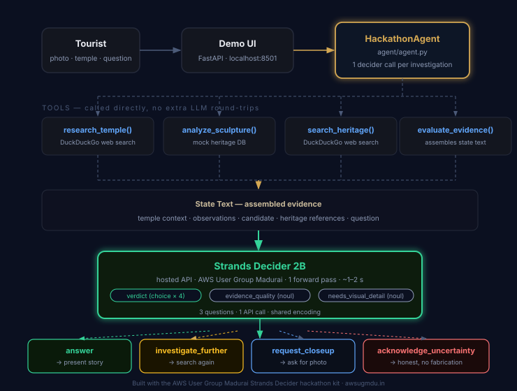

# StoryStone — The Curious Heritage Detective

> **Every sculpture has a story. StoryStone investigates the clues and discovers it.**

StoryStone is an AI-powered heritage discovery agent that helps tourists understand
the mythological and historical stories behind temple sculptures they photograph —
without needing a guide or specialist knowledge.

A tourist enters a temple name and city, receives a researched introduction, uploads
a sculpture photo, and watches StoryStone investigate its possible meaning before
presenting an understandable, evidence-backed story.

**Tags:** `#strands-decider-2b` `#policy`

Built with the **AWS User Group Madurai** Strands Decider hackathon kit.

---

## What makes it different

Most AI image tools describe what they see. StoryStone **investigates**:

1. Researches the temple's history and legends (DuckDuckGo web search)
2. Analyses visible iconographic details — posture, mudras, attributes, vahana
3. Searches heritage references for matching mythology and iconography
4. Assembles all evidence into a structured state text
5. Asks **Strands Decider 2B** whether the evidence is strong enough — and which investigation path to take
6. Narrates the best-supported story, or asks for a closer photo, or honestly admits uncertainty

The key moment: **Strands Decider 2B classifies the investigation verdict** before any story is told.

---

## The decision handed to Strands Decider 2B

**Pattern:** `#policy` — Evidence sufficiency classification

After assembling temple context, visual observations, a candidate identification, and
retrieved heritage references, the decider reads the full evidence text and answers
three typed questions in one forward pass:

| Question | Type | Options |
|---|---|---|
| `verdict` | choice | `answer` / `investigate_further` / `request_closeup` / `acknowledge_uncertainty` |
| `evidence_quality` | noul | Are references sufficient and non-contradictory? |
| `needs_visual_detail` | noul | Is a key attribute unclear and critical? |

**Why a decision model instead of an LLM judge?**

The verdict requires reading prose evidence and weighing whether references *actually*
match visual observations — whether an ambiguity is critical, whether sources contradict.
An `if` statement on counts cannot do this. An LLM judge adds latency and cost to every
investigation. Strands Decider 2B makes the call in one forward pass: calibrated
probabilities the code can branch on, ~1–2 s, at a fraction of the cost.

**Verdict actions:**

```
answer                → present the sourced story
investigate_further   → run search_heritage_references again with different terms
request_closeup       → ask the tourist for a focused close-up photo
acknowledge_uncertainty → present observations honestly, no fabricated identification
```

---

## Features

- **Temple introduction** — dynamic research with history, legends, and source URLs
- **Iconographic analysis** — posture, mudras, attributes, vahana, companions
- **Adaptive investigation** — the decider drives the next action, not a fixed pipeline
- **Evidence-backed story** — structured sections: identification, clues, narrative, significance, sources, confidence
- **Follow-up questions** — answered from assembled context, no re-investigation needed
- **Deployed on AWS** — Amazon Bedrock AgentCore Runtime with Amazon Nova Pro

---

## Architecture



> *Dark boxes = components. Gold border = the agent. Green glow = Strands Decider 2B (the decision point). Dashed arrows = data flow.*

```
Tourist
  │
  ├─ temple name + city ──> research_temple() ──> DuckDuckGo search
  │                                └─> LLM (1 call): temple introduction
  │
  └─ sculpture photo + text
        │
        ├─ analyze_sculpture()        ← mock iconographic DB (keywords → observations)
        ├─ search_heritage_references() ← DuckDuckGo web search
        ├─ evaluate_evidence()         ← assembles structured state text
        │
        ├─> Strands Decider 2B ────────── verdict + evidence_quality + needs_visual_detail
        │         (1 forward pass, ~1–2 s, hosted API)
        │
        └─> LLM (1 call): final story narration  ← AWS User Group Madurai cloud (local dev)
                                                   Amazon Bedrock Nova Pro (when deployed)
```

**LLM calls per investigation: 2** (temple intro + story narration)
Strands Decider calls: 1 (verdict classification, 3 questions)

---

## Benchmark

| Metric | Strands Decider 2B | LLM baseline (qwen3.5-4b) |
|---|---|---|
| Accuracy (tune split, 11 cases) | **57.6%** overall / **81.2%** when confident (≥0.7) | 81.8% |
| Latency p50 per decision | **5,639 ms** (hosted API) | 23,355 ms |
| Latency p95 | 8,188 ms | 31,207 ms |
| Cost per 1,000 decisions | $0.035 | $0.000 (free tier) |
| Decisions answered at ≥0.7 confidence | 48% | 100% |

**Key insight:** When the decider is confident (p ≥ 0.7), accuracy matches the LLM (81%).
The 48% that fall below 0.7 confidence trigger the low-confidence note in the story — an honest
signal that the tourist should verify with a guide. The decider is **4.1× faster** than the LLM baseline.

*Run `.\kit.cmd bench --split test` to reproduce on the held-out test split.*

---

## Running locally

**Requirements:** Python 3.12, uv, an AWS User Group Madurai key from [awsugmdu.in](https://www.awsugmdu.in)

```bash
# 1. Install and set up (Windows)
.\kit.cmd setup --yes --llm ugmdu --mode ugmdu --key <your-key>

# 2. Run tests
.\kit.cmd test

# 3. Start the demo UI
.\kit.cmd demo-bg
# Open http://localhost:8501
```

**Environment variables** (written by `kit setup` to `.env`):

| Variable | Purpose |
|---|---|
| `LLM_PROVIDER` | `ugmdu` (dev) or `bedrock` (deployed) |
| `DECIDER_MODE` | `ugmdu` (hosted Strands Decider 2B API) |
| `DECIDER_API_KEY` | Your AWS User Group Madurai key |
| `BEDROCK_MODEL_ID` | Amazon Nova Pro (deployed agent) |
| `OLLAMA_URL` | Optional: Ollama for local vision analysis |
| `VISION_MODEL` | Optional: `qwen3.5:4b` for sculpture photo description |

---

## Trying it

1. Open [http://localhost:8501](http://localhost:8501)
2. Enter **Meenakshi Amman Temple** / **Madurai** → click **Discover This Temple**
3. Type: *"I see a figure with four arms dancing in a ring of fire, standing on a small dwarf"*
4. Watch the Strands Decider 2B panel on the right — the verdict bars show how confident the decider is
5. Ask a follow-up: *"What does the drum in the upper right hand represent?"*

---

## Project structure

```
agent/
  AGENT.md            use case description
  agent.py            HackathonAgent — direct tool calls + 1 LLM call for narration
  decision.py         InvestigationPolicy (#policy) — REUSABLE DECISION PATTERN
  tools.py            research_temple, analyze_sculpture, search_heritage_references, evaluate_evidence
  data/sculptures.json  iconographic mock data (5 major South Indian deities)
  eval_cases.jsonl    24 labelled cases (12 tune / 12 test)
  demo_script.yaml    3-turn demo script
decider_kit/          reusable library (AWS User Group Madurai kit)
demo/                 FastAPI + HTML demo UI
.kiro/specs/storystone/  requirements, design, tasks
```

---

## Reusable decision pattern

`agent/decision.py` contains a fully reusable `#policy` pattern you can copy into any agent
that needs to classify whether assembled evidence is sufficient before acting:

```python
from agent.decision import InvestigationPolicy, QUESTIONS
policy = InvestigationPolicy(decider)
verdict = policy.check(evidence_state_text)
# verdict.action in ("answer", "investigate_further", "request_closeup", "acknowledge_uncertainty")
```

The pattern works for any "is this evidence/content good enough to act on?" decision:
content moderation, claim verification, document review, research sufficiency.

---

## Deployment

> **Current status: running locally.** The agent has not yet been deployed to AWS. The submission demonstrates the full pipeline locally using the AWS User Group Madurai cloud LLM (qwen3.5-4b) and the hosted Strands Decider 2B API. Deployment to Amazon Bedrock AgentCore Runtime is the intended production path.

**When AWS credentials are available**, deploy with:

```bash
# Install Node + AgentCore CLI
.\kit.cmd tools install deploy --yes

# Add AWS credentials
.\kit.cmd aws-login

# Enable Amazon Nova Pro in Bedrock Model Access (AWS Console)

# Deploy to Amazon Bedrock AgentCore Runtime (~3 min)
.\kit.cmd deploy

# Verify
.\kit.cmd invoke "I'm at Meenakshi Amman Temple in Madurai. Tell me about this temple."
```

---

Built with the **AWS User Group Madurai** Strands Decider hackathon kit.
Visit [awsugmdu.in](https://www.awsugmdu.in) for the community and events.
